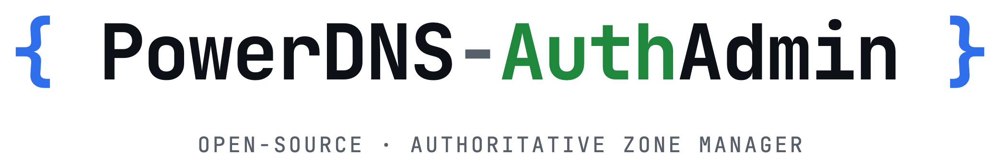

<p align="center">
  <picture>
    <source media="(prefers-color-scheme: dark)" srcset="./media/brand/logo-wordmark-dark.png" />
    
  </picture>
</p>

# powerdns-authadmin.org

[](https://github.com/PowerDNS-AuthAdmin/website/actions/workflows/ci.yml)
[](https://github.com/PowerDNS-AuthAdmin/website/actions/workflows/deploy.yml)

Source for **[powerdns-authadmin.org](https://powerdns-authadmin.org)**, the website of
[PowerDNS-AuthAdmin](https://github.com/PowerDNS-AuthAdmin/powerdns-authadmin), a modern,
self-hosted web UI for PowerDNS Authoritative: RBAC, OIDC / SAML / LDAP sign-in, passkeys,
diff-before-apply zone editing, DNSSEC, multi-backend clusters, an append-only audit log and a
built-in MCP server.

This repository holds the website only: the marketing pages, the rendered documentation
(`/docs/`, synced from the app's `docs/` folder on every release) and the search. The app's code,
releases, issues and pull requests live in
[PowerDNS-AuthAdmin/powerdns-authadmin](https://github.com/PowerDNS-AuthAdmin/powerdns-authadmin).

The site is plain HTML, CSS and a little vanilla JavaScript, generated by zero-dependency Node
scripts. No framework, no `npm install`, no CDNs: fonts, icons and search are self-hosted. The only
third-party request is Google Analytics (see [Analytics](#analytics)).

## Quick start

```sh
npm run dev                 # build, serve http://127.0.0.1:8080 and rebuild + live-reload on every change
npm run build               # → dist/
npm run check               # build, then the QA gate (SEO, links, structured data, CSP, privacy, search) and html-validate
npm run serve               # build, then serve dist/ at http://127.0.0.1:8080
```

Requires Node 20+ and nothing else: there is no `npm install`. `npm run check` fetches
[html-validate](https://html-validate.org) through `npx`.

`npm run dev` (`scripts/dev.mjs`) watches `src/`, `content/` and `scripts/`, rebuilds `dist/` on
every save, holds requests while a build runs and reloads open tabs through a small server-sent
events script that only the dev server injects. `PORT`, `HOST` and `SITE_URL` work as below.

Production is served from a domain root, but the site also works under a subpath. `SITE_URL` sets
both the absolute URL (canonical, Open Graph, sitemap, JSON-LD) and the base path every link and
asset is prefixed with:

```sh
npm run check:base          # build for http://127.0.0.1:8080/preview, then check
npm run serve:base          # same build, served at http://127.0.0.1:8080/preview/
```

`scripts/check.mjs` and `scripts/serve.mjs` read the base path from the built `dist/`, so they always
match the build you made. `DIST=<dir>` sends a build somewhere other than `dist/` (and points check
and serve at it), which is handy while `npm run dev` owns `dist/`:

```sh
DIST=/tmp/pda SITE_URL=http://127.0.0.1:9000 node scripts/build.mjs
DIST=/tmp/pda node scripts/check.mjs && DIST=/tmp/pda PORT=9000 node scripts/serve.mjs
```

`STAGING=1` builds a preview: every page is `noindex` and `robots.txt` disallows everything.

## Layout

```
src/
  site.mjs            facts used everywhere: version and release date (from the docs sync), links,
                      nav, href()/abs() and the base path
  content.mjs         copy: highlights, feature catalog, FAQs (every claim is backed by the app's docs)
  support.mjs         commercial support partials (NGN)
  pages/              one module per page (home, features, powerdns-admin-alternative, faq, support,
                      404, search)
  docs/               docs pages built from content/docs/*.md (sidebar order in nav.mjs), the ADR index
  lib/                zero-dependency Markdown renderer and syntax highlighter for the docs
  search/             build-time search indexer
  layout.mjs          <head>, SEO + Open Graph, JSON-LD, CSP, header, footer, screenshot helpers
  icons.mjs           inline SVG icons, the GitHub mark and the NGN logo
  styles/             CSS, concatenated in filename order (00-tokens.css holds every design token)
  js/                 main.js (theme, menu, tabs, copy, lightbox), docs.js, search.js,
                      analytics.js (the shared NGN GA4 event script)
  static/             copied verbatim into dist/ (fonts, icons, generated images, social cards)
content/docs/         Markdown synced from the app's docs/ (npm run sync-docs); never edited by hand
content/docs-overlay/ fixes.mjs (site-side fixes tracked by upstream issue) and new pages not upstream yet
media/                sources: app screenshots, brand marks, full woff2 fonts
scripts/
  build.mjs           renders pages, search index, sitemap.xml, robots.txt, llms.txt, llms-full.txt,
                      manifest, security.txt, humans.txt and the IndexNow key file
  check.mjs           static QA gate used by CI, the Deploy workflow and the deploy script
  build-media.mjs     screenshots → WebP, favicons and PWA icons, wordmarks, 1200×630 social cards
  build-fonts.py      media/fonts → subset woff2
  serve.mjs           tiny static server that mounts dist/ at the build's base path
  dev.mjs             dev server: rebuild on change + live reload (never used in CI)
  sync-docs.mjs       re-sync content/docs from the app repo at a release tag (or a local checkout)
  deploy.sh           rsync dist/ to the web host, smoke test, IndexNow (local and CI)
  indexnow.mjs        notify Bing / Yandex / Seznam of changed URLs
deploy/
  nginx.conf.example  reference server config (compression, caching, headers, 404)
.github/workflows/
  ci.yml              build + checks on pull requests and pushes, at the production URL and a subpath
  deploy.yml          push to main → build, check, publish dist/ to the site branch, wait, smoke test
  release-sync.yml    hourly: new app release → sync docs → pull request with a review checklist
```

## Deploying

Production is **https://powerdns-authadmin.org**, a plain nginx host serving `dist/` from a web root.
Any static host works: serve `dist/` with `404.html` as the not-found page and every page is a
directory with an `index.html`. The reference [nginx config](deploy/nginx.conf.example) adds
compression, long-lived caching for fingerprinted assets (`/assets/css/`, `/assets/js/`,
`/assets/search/`), a week for social cards, security headers and the 404 page. The copy on the
server is maintained by hand; keep the example in step with it.

**Push to main.** Every push to `main` runs `.github/workflows/deploy.yml`: it builds with
`SITE_URL=https://powerdns-authadmin.org`, runs `check.mjs` and html-validate, then commits `dist/`
(plus `build.txt`, the source commit) to the **`site` branch**. The host never accepts connections
from GitHub: a one-minute systemd timer on it (`deploy/pull-site.sh`, `pull-site.service`,
`pull-site.timer`, running as the `pda-site` user that owns the web root) fetches the `site` branch
and rsyncs it into place, fingerprinted assets first. The workflow waits until
`https://powerdns-authadmin.org/build.txt` reports its commit (up to ten minutes), smoke-tests every
URL in the sitemap (plus `/search/`, `/robots.txt`, `/llms.txt`, `/llms-full.txt`, `/sitemap.xml` and
a 404) with `scripts/smoke-test.sh`, then pings IndexNow. No secrets are involved: the repository is
public and the host only ever pulls. Run the **Deploy** workflow by hand from the Actions tab to
redeploy without a push. Deploys are serialized (`concurrency: deploy`) and never cancelled mid-way.

To set up a new host: create the `pda-site` user, give it the web root, copy the three files from
`deploy/` to `/home/pda-site/bin/` and `/etc/systemd/system/`, then
`systemctl enable --now pull-site.timer`. `journalctl -t pull-site` shows each deploy.

**By hand.** `scripts/deploy.sh` rsyncs a build straight to the host over SSH from a workstation
that is allowed to reach it, then runs the same smoke test and IndexNow ping. The target is read
from a git-ignored file, and anything set in the environment wins over it:

```sh
cp .env.example .env.deploy   # set DEPLOY_HOST, DEPLOY_PATH and DEPLOY_OWNER=pda-site:pda-site
npm run deploy                # build, check, rsync, smoke test, IndexNow
INDEXNOW=0 npm run deploy     # same, without the IndexNow ping
```

The next push to `main` replaces whatever was deployed by hand.

Pull requests and pushes run `.github/workflows/ci.yml`: build, checks, html-validate and an XML
check of the sitemap, both at the production URL and under a subpath.

## Common changes

**New app release.** The **Sync PowerDNS-AuthAdmin release** workflow
(`.github/workflows/release-sync.yml`) checks the app repo once an hour. When a new release is out, it
syncs the docs from that tag, runs the same checks as CI and opens a pull request on a
`release/<tag>` branch. The pull request lists what to review:

1. Read the release notes and update the copy in `src/content.mjs` (highlights, feature groups, FAQ
   answers) for new, changed or removed features.
2. Update the facts in the `llms.txt` block of `scripts/build.mjs` (PowerDNS versions tested,
   runtime, MCP tools) if the release changed them.
3. Remove overlay fixes whose upstream issue is closed and fixed in this release. The pull request
   shows each overlay issue's state, and the build warns about fixes that no longer change anything.
4. Refresh the screenshots if the UI changed (below).

Merging the pull request deploys the site. The version, release date, release links, JSON-LD
`softwareVersion`, `llms.txt`, docs "Updated" dates, the sitemap's `lastmod` and the `security.txt`
expiry all come from `content/docs/_source.json`, so nothing else needs a version bump. To sync by
hand, run the workflow with a tag, or run `npm run sync-docs -- --ref vX.Y.Z` locally. The workflow
needs **Settings → Actions → General → Allow GitHub Actions to create and approve pull requests**.

**Docs sync.** `content/docs/` is a copy of the app's `docs/` (`NN-NAME.md` guides, `FEATURES.md`,
`dev-setup.md` and `adr/*.md`), plus `_source.json` (repo, ref, commit, version, release date and
per-file upstream commit dates used for "Updated" and the sitemap's `lastmod`). `docs/README.md`,
`adr/README.md` and the ADR template are skipped: the site generates `/docs/` and `/docs/adr/`
itself. Every docs page links back to its source in the app repo at the synced tag ("Edit this page
on GitHub", "View source"), so fixes go upstream:

```sh
npm run sync-docs -- --ref v1.9.1                              # download that tag from GitHub (gh, else curl)
npm run sync-docs -- ../PowerDNS-AuthAdmin --ref v1.9.1        # copy from a local checkout, record the tag's commit
```

Cross-doc links become site links (`02-INSTALLATION.md` → `/docs/installation/`,
`adr/0004-x.md` → `/docs/adr/0004-x/`), links to other repo files (`CHANGELOG.md`, `.env.example`,
`provisioning.example.yaml` ...) point at GitHub at the synced ref, and heading ids follow GitHub's
slugs so upstream anchors keep working. Screenshots referenced from `FEATURES.md` are swapped for
the site's own WebP copies when the name is known (`src/shots.json`), otherwise the picture becomes a
link to the file on GitHub. The build warns about anchors that don't resolve.

**Docs overlay.** Problems in the upstream docs are fixed upstream first: open an issue on the app
repo, then, if the site shouldn't wait, add an entry to `content/docs-overlay/fixes.mjs`:

```js
{ issue: 123, file: "installation.md", title: "Post-install steps numbered 1 to 6", apply: (md) => md.replace(...) }
```

`apply` runs on the synced markdown at build time. When a sync brings in the upstream fix, `apply`
no longer changes anything and the build prints `overlay fix for #123 ... no longer applies`: delete the
entry. A page upstream doesn't have yet lives next to it as `content/docs-overlay/<slug>.md`, with an
`issue` on its entry in `src/docs/nav.mjs`; its "Edit" link points at that issue. Once upstream ships
`docs/<slug>.md`, the synced copy wins and the build tells you to delete the overlay file.

**Copy.** Edit `src/content.mjs` (highlights, features, FAQs) or the page module. Keep claims factual
and sourced from the app's README, docs or changelog. FAQ answers should stand on their own: answer
engines quote them out of context. Write internal links as `/docs/...`; they are prefixed with the
base path at build time.

**Screenshots.** Copy PNGs from the app repo's `screenshots/{dark,light}/` into
`media/screenshots/{dark,light}/` (desktop 1440×900, the `-mobile` captures 830×1848; the app's own
screenshot runner makes them from demo data), then regenerate the derived images. Needs ImageMagick 7,
`cwebp`, `oxipng` and Chrome or Chromium:

```sh
npm run media                            # everything: screenshots, icons, og cards, README wordmarks
node scripts/build-media.mjs shots og    # or just some of them
```

Each screenshot becomes stripped WebP at 1440, 960, 720 and 640 px (830 and 415 px for mobile) in
`src/static/assets/img/shots/`, listed in `src/shots.json` (dimensions for `width`/`height`, so no
layout shift). Pages emit both theme variants as lazy images and CSS shows the one matching the site
theme, so only one is downloaded. Generated files are committed, so a normal build never needs those
tools.

**Fonts.** `src/static/assets/fonts/` holds subset Inter and JetBrains Mono (from `media/fonts/`:
Latin-1 plus the punctuation the copy uses, weight axis trimmed to what the CSS asks for).
Regenerate with `python3 scripts/build-fonts.py` (needs `pip install fonttools brotli`) and keep the
weight ranges in the `@font-face` rules in step with the script.

**New page.** Add a module under `src/pages/`, register it in `src/pages/index.mjs`, add an `og`
block and run `node scripts/build-media.mjs og`. New docs pages come from markdown instead: see the
docs overlay above. It joins the sitemap, `llms.txt`, the search index and the checks automatically.

## SEO and answer engines

- Unique title and description per page, canonical URLs, `max-image-preview:large`.
- One JSON-LD graph per page: `Organization`, `WebSite` with a `SearchAction`, `WebPage`,
  `BreadcrumbList`, `SoftwareApplication` + `SoftwareSourceCode` on the home page, `FAQPage` on
  `/faq/` only and `TechArticle` on docs pages.
- `sitemap.xml` with `lastmod` (docs pages carry their upstream commit date) and image entries, and
  `robots.txt` that welcomes AI crawlers by name.
- `llms.txt` (a link-rich summary with a Documentation section) and `llms-full.txt` (the full text
  of every doc).
- Per-page 1200×630 social cards, including one for every docs page and ADR, full Open Graph and
  Twitter tags.
- IndexNow key: `652aab60d92521253f92abc06012277a` (served at `/652aab60d92521253f92abc06012277a.txt`,
  set in `src/site.mjs`). Every deploy pings IndexNow after the smoke test passes.

After a domain is verified in Google Search Console and Bing Webmaster Tools, submit
`https://powerdns-authadmin.org/sitemap.xml` in both.

## Analytics

GA4 property `G-Y8C640LSFR` (`ga4` in `src/site.mjs`; empty disables it). `src/js/analytics.js` is
the shared event script used on every NGN-run site, so keep it identical to the others. The build
fingerprints it and every page loads it once with `data-ga4`; it loads gtag.js itself, so there is
no inline script and the CSP in `src/layout.mjs` only needs the Google hosts.

Events: `cta_click` for button-styled links and anything with `data-cta` (the attribute value is the
stable `cta_text`, so keep labels like `Live demo`, `Star on GitHub`, `Docs`, `Installation guide`
consistent across pages), `email_click` for `mailto:` links. `cta_location` is inferred
(header, nav, hero, footer, body); `data-cta-location` overrides it. Outbound clicks to GitHub are
covered by GA4 enhanced measurement. The footer states that the site uses Google Analytics, with
the opt-out link.

## Privacy and security

Google Analytics is the only third party; there are no other cookies, CDNs or external requests, and
search runs in the browser against a self-hosted index. A strict Content Security Policy is set per
page (the only inline script, the theme boot script, is allowed by hash). `check.mjs` fails the
build on third-party resources other than Google Analytics, inline event handlers, an inline script
whose hash is not in the CSP, and email addresses outside the RFC 2606 example domains.

## Contributing

Issues and pull requests are welcome. Please run `npm run check` before opening a PR. For the app
itself, head to [PowerDNS-AuthAdmin/powerdns-authadmin](https://github.com/PowerDNS-AuthAdmin/powerdns-authadmin).

## License

Website code: [MIT](LICENSE). Documentation content under `content/docs/` is © the PowerDNS-AuthAdmin
contributors, licensed under MIT like the app. Fonts: Inter and JetBrains Mono under the SIL Open
Font License (see `src/static/assets/fonts/`). PowerDNS-AuthAdmin is a community project; its marks
and screenshots belong to the project. PowerDNS is a trademark of its respective owner; this site and
the app are independent and not affiliated with or endorsed by PowerDNS or Open-Xchange.
